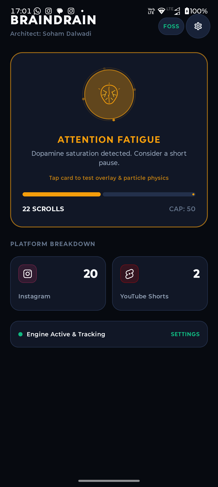
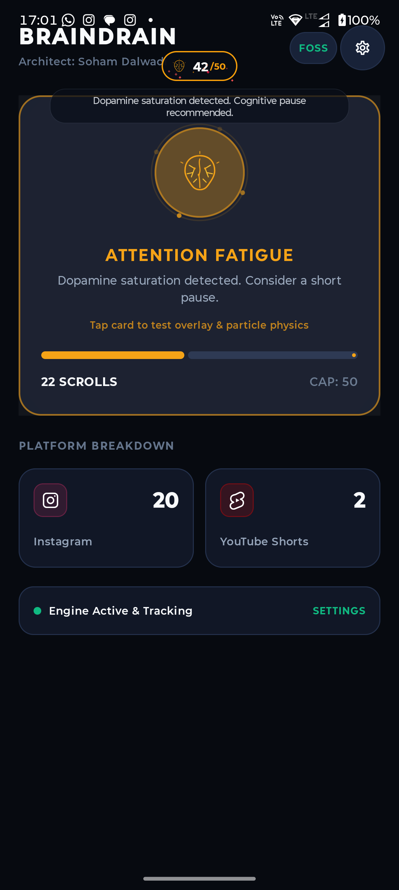
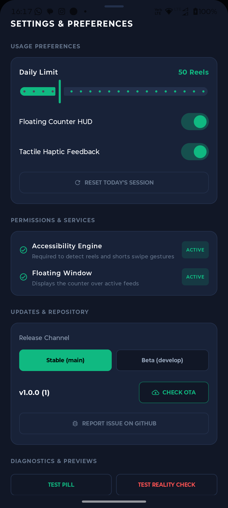
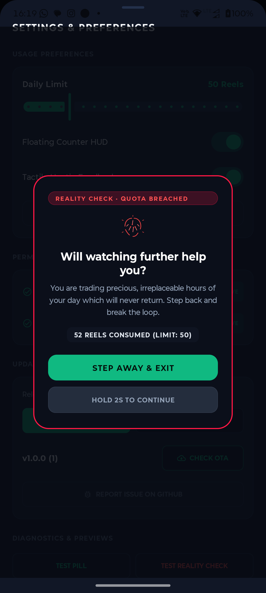

# BrainDrain

**Architect & Lead Developer:** Soham Dalwadi  
**License:** MIT / Apache-2.0 (100% Free & Open Source Software)  
**Philosophy:** Zero Subscriptions. Zero Ads. Zero Trackers. 100% Offline & Private.  
**Design Standard:** Minimalist Obsidian & Vector Aesthetic (Strictly Zero Emojis).

---

## What is BrainDrain?

Short-form algorithmic video feeds (such as Instagram Reels and YouTube Shorts) utilize variable-ratio dopamine reinforcement schedules engineered to keep users scrolling in a dissociative, hypnotic loop. By removing natural stopping points, time perception is impaired, and valuable hours of focused attention are lost every day.

**BrainDrain** is an autonomous, on-device digital wellbeing HUD utility that restores mindful awareness and breaks doomscrolling loops through real-time feedback and progressive psychological friction.

Unlike commercial screen-time blockers that lock basic daily limits behind recurring subscriptions or collect usage telemetry, BrainDrain is:
* **100% Free & Open Source:** Full functionality forever. No pro tiers, no paywalls, no trials.
* **Completely Private & Local:** Operates entirely on your device with zero tracking and zero telemetry.
* **Ultra-Low Overhead:** Built in modern Kotlin, Jetpack Compose, Material 3, and Kotlin Coroutines.
* **Pure Vector Aesthetic:** Obsidian glass theme with custom geometric vector graphics, hardware-accelerated particle physics, and zero emojis.

---

## Visual Showcase

| Main Dashboard | Floating HUD & Sparks | Configuration Panel | Reality Check Modal |
| :---: | :---: | :---: | :---: |
|  |  |  |  |
| *Real-time neural state engine with breathing aura* | *Live counter with welding sparks & stoic nudge* | *Custom caps, haptics, and OTA channel switch* | *Deliberate exit friction & 2-second hold release* |

---

## How It Works: The Progressive Friction Model

BrainDrain does not abruptly sever your access or cause frustration. Instead, it guides your attention back to the physical world using progressive cognitive cues calibrated to your daily scroll budget:

```
[Scroll 0] ─────────────── [50% Limit] ─────────────── [70% Limit] ─────────────── [100% Limit]
 Optimal State               Focus State                Fatigue State              Depleted State
 Emerald Glow               Cyan Accents              Amber Welding Sparks       Crimson Ember Meltdown
 Fluid Experience           Mindful Awareness         Stoic Reality Nudges       Center Reality Check Modal
```

### 1. The Floating Pill HUD
* Anchored non-intrusively in your status bar or camera notch region (Dynamic Island style).
* Ultra-compact footprint (~90x32 dp) that never blocks feed navigation, back buttons, or comment sections.
* Draggable to any screen location to suit your device layout.

### 2. Neural State Engine
* **Optimal (0 - 50% Cap):** Clean Emerald green aura. Cognitive reserve is high.
* **Focus (50 - 70% Cap):** Subtle Cyan indicator. Mindful pacing cue.
* **Attention Fatigue (70 - 100% Cap):** Amber gold glow. On every swipe, a hardware-accelerated Canvas engine emits golden welding sparks with bright kinetic heads. A non-blocking psychological reality nudge slides down from the camera cut-out to prompt conscious reflection.
* **Attention Depleted (100%+ Cap):** Crimson red glow. Rising thermal ember particles drift from the capsule base like glowing coals.

### 3. Center Reality Check Intervention
When your daily threshold is reached, BrainDrain surfaces a high-impact reality check dialog:
> "Will watching further help you? You are trading precious, irreplaceable hours of your day which will never return. Step back and break the loop."

To prevent mindless bypassing:
* **Step Away & Exit:** Instantly returns you to your home launcher.
* **Hold to Continue:** Imposes a mandatory 2-second hold-to-confirm physical interaction, transforming an impulsive click into a conscious, deliberate choice.

---

## Key Features

* **Real-Time Gesture Tracking:** Custom accessibility engine accurately identifies short-form swipe gestures on **Instagram Reels** and **YouTube Shorts** with debounce and inertia filtering. It detects when comments sheets are opened to prevent false counts.
* **Vector Particle Physics:** Hardware-accelerated canvas particle emitter delivering dynamic welding sparks and thermal ember convection currents.
* **Tactile Haptic Feedback:** Subtle vibration ticks on scroll milestones to anchor digital actions with physical sensation.
* **In-App Over-The-Air (OTA) Updates:** Built-in updater supporting both **Stable (`main`)** and **Beta (`develop`)** channels. Checks GitHub Releases directly, downloads update APKs with background notifications, and triggers Android package installation without requiring Google Play Services.
* **Direct GitHub Issue Integration:** Built-in bug reporter and feature request launcher to file issues directly on GitHub with device specs pre-populated.
* **Custom Daily Caps:** Configurable daily limits with session reset capability.

---

## Technical Architecture

BrainDrain is structured around modular, testable components designed for performance and zero battery drain:

```
app/src/main/java/com/dalwadi/braindrain/
├── BrainDrainApp.kt                      # Application lifecycle entry point
├── core/
│   ├── data/
│   │   └── PreferencesRepository.kt      # DataStore-backed persistent offline storage
│   ├── detector/
│   │   ├── PlatformDetector.kt           # Extensible detector interface
│   │   ├── InstagramDetector.kt          # Instagram Reels detector with comments-sheet guard
│   │   ├── YouTubeShortsDetector.kt      # YouTube Shorts detector
│   │   └── DetectorRegistry.kt           # Central detector registry
│   ├── model/
│   │   ├── AppPlatform.kt                # Platform declarations
│   │   ├── BrainState.kt                 # Brain state thresholds & vector mappings
│   │   └── ScrollSession.kt              # Session state data model
│   └── ota/
│       ├── ApkDownloader.kt              # Android DownloadManager APK installer
│       ├── OtaChannel.kt                 # Stable vs Beta channel declarations
│       └── OtaUpdateChecker.kt           # GitHub Releases manifest parser
├── overlay/
│   ├── OverlayManager.kt                 # WindowManager overlay lifecycle & layout bounds
│   └── ParticleEmitterView.kt            # Hardware-accelerated 60 FPS particle canvas
├── service/
│   └── BrainDrainAccessibilityService.kt # Lightweight swipe detection accessibility engine
└── ui/
    ├── MainActivity.kt                   # Host activity with permission coordinator
    ├── DashboardViewModel.kt             # Reactive MVVM/MVI state holder
    ├── DashboardScreen.kt                # Jetpack Compose dashboard with breathing vector aura
    └── theme/                            # Minimalist obsidian dark theme tokens
```

---

## Permissions & Privacy Architecture

BrainDrain requires only the minimal permissions necessary to deliver its functionality:

| Permission | Purpose | Privacy Guarantee |
| :--- | :--- | :--- |
| **Accessibility Service** | Detects vertical swipe scroll events specifically inside supported short-form video feeds. | **Strictly Local:** BrainDrain does not inspect text, keystrokes, personal messages, or user credentials. Data never leaves the device. |
| **Display Over Other Apps** | Renders the compact floating pill HUD, spark particle layer, and reality check intervention. | Anchored exclusively inside your WindowManager. |
| **Post Notifications** | Provides OTA download progress notifications and background update alerts. | Standard Android notification channel. |
| **Internet Access** | Used exclusively for the optional in-app OTA update check against GitHub Releases. | **Zero Telemetry:** No user analytics, metrics, or logs are transmitted. |

---

## Release Channels

BrainDrain follows semantic versioning and separates production builds from bleeding-edge updates:

| Channel | Branch | Manifest | Target Audience |
| :--- | :--- | :--- | :--- |
| **Stable** | `main` | `latest.json` | Production builds tagged `vX.Y.Z`. Thoroughly tested and verified. |
| **Beta** | `develop` | `latest-beta.json` | Pre-release builds with early features, new platform detectors, and UX refinements. |

You can toggle between Stable and Beta channels anytime within the in-app Settings sheet.

---

## Building from Source

### Prerequisites
* JDK 17+ (or Android Studio bundled JBR)
* Android SDK 34 / 35
* Android Studio Iguana or newer

### Build Instructions
```powershell
# Set Java Home (example using Android Studio bundled JBR)
$env:JAVA_HOME = "C:\Program Files\Android\Android Studio\jbr"

# Verify Kotlin compilation
.\gradlew compileDebugKotlin

# Assemble Debug APK
.\gradlew assembleDebug

# Install on connected device via ADB
adb install -r app/build/outputs/apk/debug/app-debug.apk
```

---

## Contributing

Contributions from the developer community are welcome.
* To add support for additional platforms (such as TikTok, Reddit, or Facebook Reels), implement the `PlatformDetector` interface.
* Review [CONTRIBUTING.md](CONTRIBUTING.md) for code conventions, zero-emoji policy, and testing requirements.
* Report bugs and suggest enhancements via GitHub Issues or the in-app reporter.

---

## Author & Credits

* **Architect & Lead Developer:** [Soham Dalwadi](https://github.com/sohamdalwadi)
* **Project Repository:** [https://github.com/sohamdalwadi/BrainDrain](https://github.com/sohamdalwadi/BrainDrain)
* **License:** Licensed under the MIT and Apache-2.0 Licenses.
